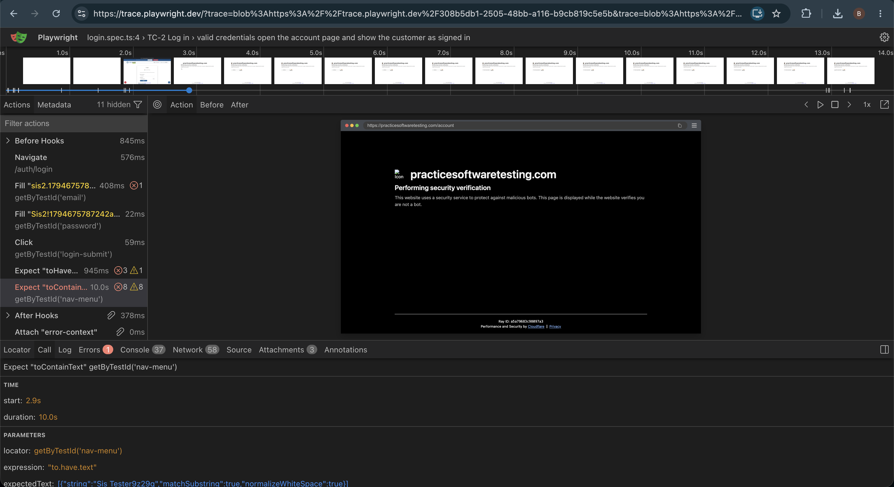

# SIS 2 — Playwright tests for the Toolshop

[](https://github.com/bekasyll/sis2-playwright/actions/workflows/playwright.yml)

End-to-end tests for <https://practicesoftwaretesting.com>, written with Playwright Test in TypeScript.
Software Testing and Debugging, KBTU 2026 · Assylbekov Bekassyl

| Document | Contents |
|----------|----------|
| [Description.md](Description.md) | What is automated, the test cases, decisions, what is not automated |
| [Prompt.md](Prompt.md) | The AI tool and the exact prompts |
| [Review.md](Review.md) | How the AI output was reviewed and changed |
| [screenshots/](screenshots/) | AI response, run results, report |

## Run it

Requires Node.js 20 or newer.

```bash
npm ci
npx playwright install chromium
npx playwright test
npx playwright show-report
```

Other ways to run:

```bash
npx playwright test --ui                 # UI mode: pick tests, time-travel through steps
npx playwright test tests/login.spec.ts  # one file
npx playwright test --headed             # watch the browser
npm run test:bugs                        # same suite against the deliberately buggy build
```

`npm run test:bugs` uses Unix syntax for environment variables. In Windows PowerShell, run it like this instead:

```powershell
$env:BASE_URL="https://with-bugs.practicesoftwaretesting.com"; $env:API_URL="https://api-with-bugs.practicesoftwaretesting.com"; npx playwright test
```

The tests use the public, shared site. No seeded account is used and no setup is needed: every test creates its own customer with a unique email.

## Structure

```
tests/          one spec per test case: what must be true, no locators
pages/          one page object per screen: how to do it
fixtures/       hands page objects, an API helper and fresh customers to every test
data/           customer factory (unique email per call), price helpers
api/            REST calls used for setup and for checking outcomes
playwright.config.ts
```

## Tests

| File | Tests |
|------|-------|
| `register.spec.ts` | New customer registers → login page, account works · Duplicate email rejected |
| `login.spec.ts` | Valid credentials → account page, name in header · Wrong password → error, not signed in |
| `buy-product.spec.ts` | Two units to cart → correct line → checkout → invoice number |
| `compare-products.spec.ts` | Two products → comparison table shows the same two, each with its catalogue price |
| `reset-password.spec.ts` | Known email → confirmation, new password works, old one does not · Unknown email → error |

## Rules this suite follows

- No `waitForTimeout`. Only web-first assertions and auto-waiting actions.
- No CSS classes and no XPath. Locators are `getByTestId` (the app uses `data-test`, set in the config), `getByRole`, or a data-format text match.
- No locator in any spec file.
- Every test is independent and creates its own data, so tests can run in parallel and in any order.
- Retries only in CI. A trace is recorded on the first retry.

## CI

[](https://github.com/bekasyll/sis2-playwright/actions/workflows/playwright.yml)

**CI system:** GitHub Actions. The repository already lives on GitHub, so Actions needs no server of its own, is free for a public repository, keeps artefacts next to the run, and supports a job matrix for sharding out of the box. (Jenkins, covered in Week 10, would need its own server and a tunnel for GitHub webhooks.)

**Pipeline** (`.github/workflows/playwright.yml`):

- runs on every push to any branch and on every pull request (plus `workflow_dispatch` for manual runs);
- `actions/setup-node` with `cache: npm` (keyed on `package-lock.json`), then `npm ci`;
- Chromium installed with system dependencies: `npx playwright install --with-deps chromium`;
- the full suite, no `--grep` or `--project` filters, split into 4 shards (`--shard=i/4`) running in parallel; `fail-fast: false` so one red shard does not cancel the others;
- the `merge-reports` job downloads the 4 blob reports and merges them into one HTML report and one JUnit file (`merge.config.ts`);
- reports and traces are uploaded with `if: !cancelled()`, i.e. also when tests fail;
- `concurrency` cancels an outdated run when a new commit is pushed to the same branch.

The npm cache is restored from the second run on: the `setup-node` log shows `Cache restored from key: node-cache-Linux-x64-npm-…` ([screenshot](screenshots/09-ci-npm-cache-restored.png), run [43621806938](https://github.com/bekasyll/sis2-playwright/actions/runs/43621806938)).

**Runs** for the submission:

| Event | Run |
|-------|-----|
| push to a feature branch (`ci-demo`) | [43623574391](https://github.com/bekasyll/sis2-playwright/actions/runs/43623574391) |
| pull request ([#2](https://github.com/bekasyll/sis2-playwright/pull/2), `ci-demo` → `main`) | [43623624459](https://github.com/bekasyll/sis2-playwright/actions/runs/43623624459) |
| push to `main` | [43621806938](https://github.com/bekasyll/sis2-playwright/actions/runs/43621806938) |

**Artefacts** (Actions → the run → Artifacts), kept for 14 days:

| Artefact | Contents |
|----------|----------|
| `playwright-report` | merged HTML report of all 4 shards, traces included |
| `test-results-1` … `test-results-4` | per shard: traces, screenshots and videos of failed/retried tests, `reports/junit.xml` |
| `junit-report` | merged `junit-merged.xml` |
| `blob-report-1` … `blob-report-4` | intermediate shard reports, kept 1 day |

To open a trace: download the artefact, then `npx playwright show-trace trace.zip`, or drop the file onto <https://trace.playwright.dev>.



The trace above is from the `test-results-2` artefact of run [43618892900](https://github.com/bekasyll/sis2-playwright/actions/runs/43618892900): it is how the Cloudflare bot check (see below) was found.

**CI settings** (`playwright.config.ts`, active when `CI` is set; GitHub Actions sets it automatically):

| Setting | Locally | In CI | Why |
|---------|---------|-------|-----|
| `forbidOnly` | `false` | `true` | a forgotten `test.only` fails the run instead of silently running one test |
| `retries` | `0` | `2` | the site is a shared public demo; a slow response makes a test *flaky*, not red |
| `workers` | auto | `2` | GitHub runners have 2–4 vCPUs |
| `reporter` | `list`, `html` | `list`, `blob`, `junit` (`reports/junit.xml`) | blob for merging shards, JUnit for any CI tool |
| `trace` | `on-first-retry` | `on-first-retry` | a trace of exactly the attempt that failed |

`fullyParallel: true` lets `--shard` split individual tests, not whole files. `BASE_URL` and `API_URL` can be set under Settings → Secrets and variables → Actions → Variables; if they are not set, the public Toolshop is used.

### Known limitation: Cloudflare bot check on GitHub runners

The Toolshop is behind Cloudflare. After a successful login the app reloads `/account`, and from GitHub runner IPs (Azure data centres) Cloudflare answers that request with its "Performing security verification" page (`403`, `cf-mitigated: challenge`) instead of the account page. The login API call itself succeeds (`200`). Evidence: the failure screenshot, page snapshot and trace in the `test-results-2` artefact of run [43618892900](https://github.com/bekasyll/sis2-playwright/actions/runs/43618892900). From a home IP and in the Playwright Linux container the same test passes.

Retries do not help (the bot check is shown every time), and getting around the bot check would mean circumventing the site's protection. So TC-2a detects the bot check page (`BasePage.isBlockedByBotCheck()`) and is reported as **skipped** with the reason "Cloudflare bot check on /account (runner IP), not an application defect". In every other case, including locally, the test runs and asserts as before; if neither the header nor the bot check appears, the test still fails.

### Runtime

"Before" is the same workflow with one job (`shardIndex: [1]`, `shardTotal: [1]`), "after" is the 4-shard version. Both numbers come from GitHub Actions.

| Configuration | Total run time | Run tests step (slowest shard) | Run |
|---------------|----------------|--------------------------------|-----|
| 1 job, no sharding | 1 min 19 s | 40 s | [43621442484](https://github.com/bekasyll/sis2-playwright/actions/runs/43621442484) |
| 4 shards + merge | 1 min 20 s (another run: 1 min 24 s) | 23 s (another run: 26 s) | [43621614217](https://github.com/bekasyll/sis2-playwright/actions/runs/43621614217), [43620105900](https://github.com/bekasyll/sis2-playwright/actions/runs/43620105900) |

Per job in the 4-shard run 43621614217: shards took 31–50 s each (the tests themselves 5–23 s), then `Merge reports` took 26 s.

Conclusion: sharding cut the test step of the slowest job from 40 s to 23–26 s, but the total run time did not change (about 1 min 20 s), because the suite has only 8 tests: each shard spends ~25 s on checkout, `npm ci` and the Chromium install, the merge job adds 13–26 s after the shards, and one shard still carries the slowest test (TC-3, the checkout flow). Sharding would start to pay off once the suite's own run time is well above this fixed ~40 s overhead.

Measured from single push runs (not a median of three `workflow_dispatch` runs): starting a manual run needs the GitHub UI or an authenticated API call.

### Running locally in CI mode

```bash
npm ci
npx playwright install --with-deps chromium   # --with-deps only matters on Linux
CI=true npx playwright test                   # PowerShell: $env:CI="true"; npx playwright test
```

Shards and the report merge, the same way CI does it:

```bash
mkdir -p all-blob-reports
CI=true npx playwright test --shard=1/2 && cp blob-report/*.zip all-blob-reports/
CI=true npx playwright test --shard=2/2 && cp blob-report/*.zip all-blob-reports/
npx playwright merge-reports --config merge.config.ts ./all-blob-reports
npx playwright show-report
```

Checked locally before the first push: the CI run writes `blob-report/` and `reports/junit.xml`; with a temporary `test.only` the CI run fails (`exit 1`, error points at the `test.only` line); two shards merge into one report with all 8 tests in `reports/junit-merged.xml`.
