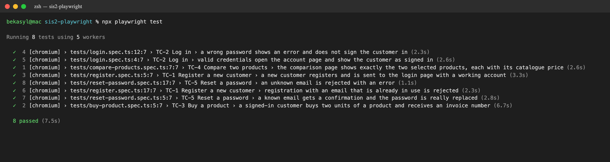
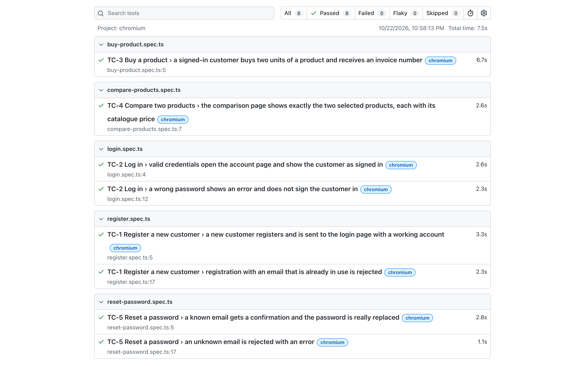
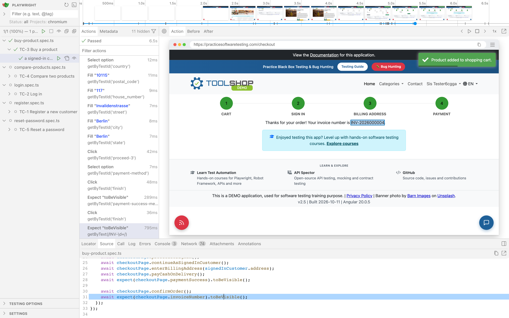
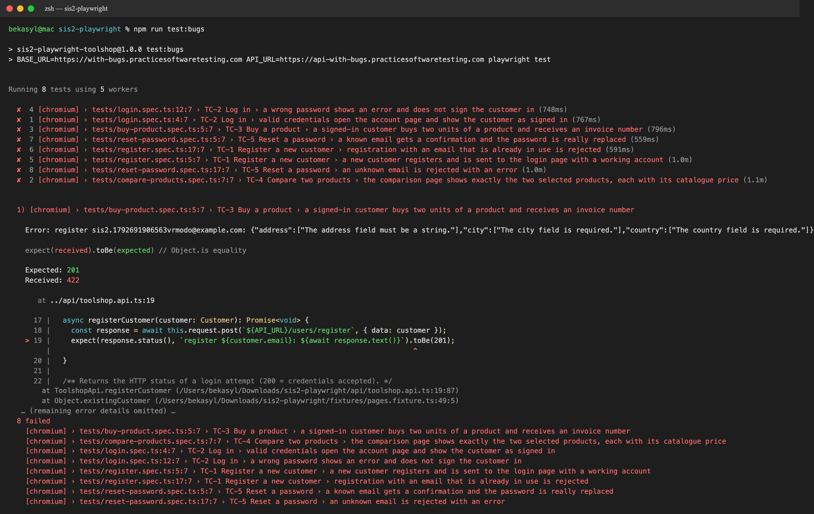
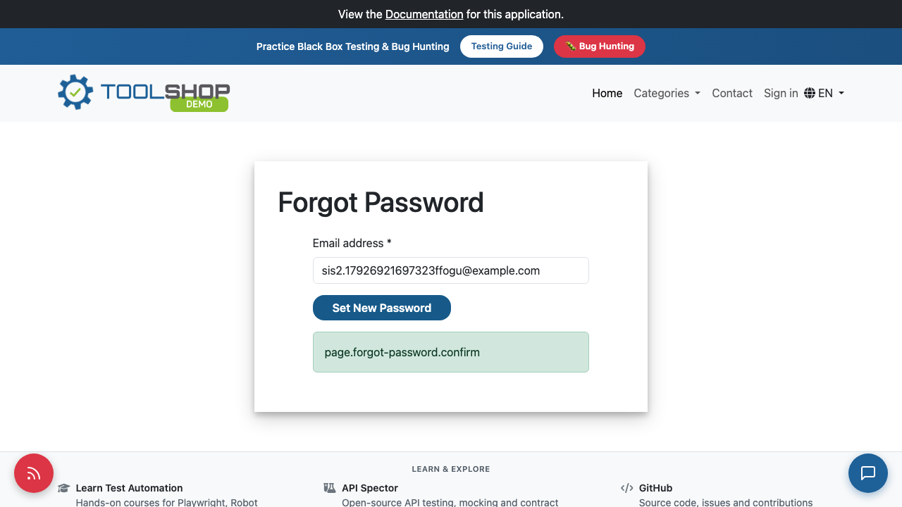

# Screenshots

Put the images in this folder and keep the file names below, so the links work.

| File | What to capture |
|------|-----------------|
| `01-ai-response.png` | The AI conversation: the prompt from Prompt.md and the start of the answer |
| `02-run-terminal.png` | Terminal after `npx playwright test`: the list of 8 tests and the "passed" summary |
| `03-html-report.png` | `npx playwright show-report`: the overview page |
| `04-ui-mode.png` | `npx playwright test --ui` with the buy-product test selected and its steps visible |
| `05-with-bugs-run.png` | `npm run test:bugs`: which tests go red against the buggy build |
| `06-ci-run.png` | GitHub → Actions: a green workflow run (optional) |
| `07-bug-forgot-password-raw-key.png` | Defect evidence: the forgot-password success banner shows the raw translation key `page.forgot-password.confirm` |

`02` and `05` are the real, unedited output of the commands, rendered into a terminal-style image with Playwright (the terminal had no screen-recording permission). In `05` the middle of the error details is cut, marked with "…". `03` and `04` are Playwright screenshots of the real HTML report and UI mode.

